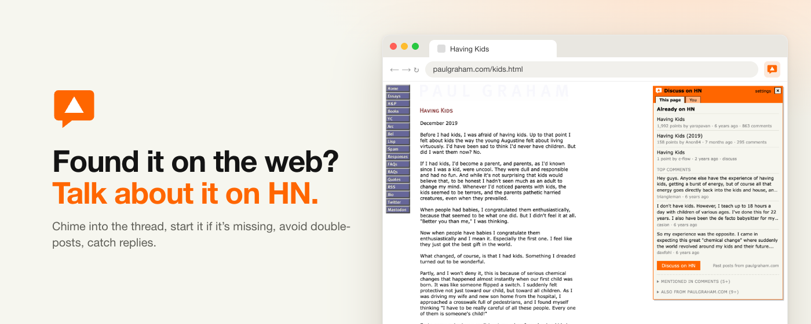
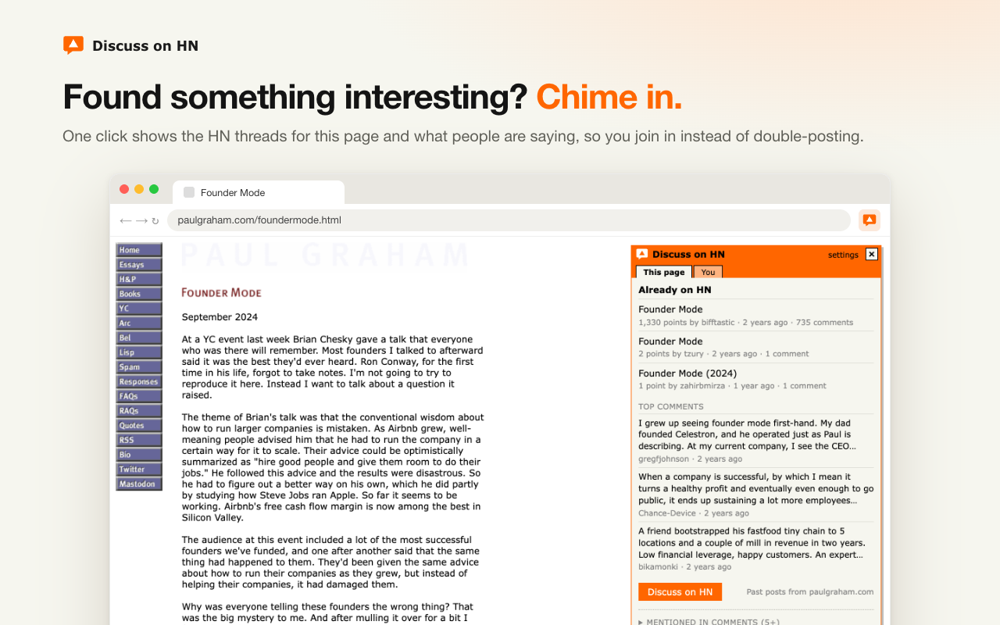
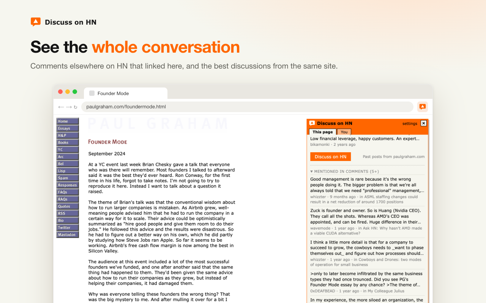
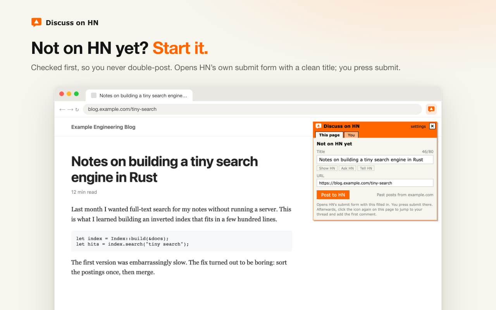
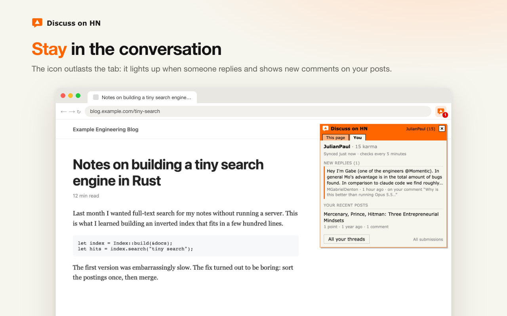
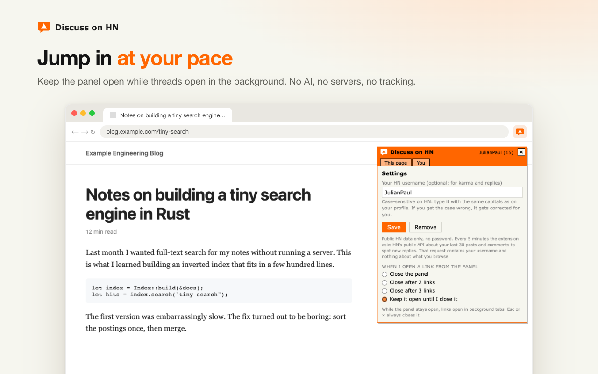
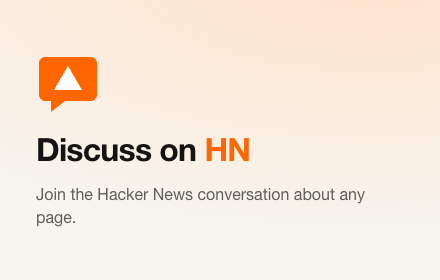

<p align="center">
  
</p>

<h1 align="center">Discuss on HN</h1>

<p align="center">
  <b>Join the Hacker News conversation about any page.</b><br>
  Chime in, start it if it's missing, never double-post, never miss a reply.
</p>

<p align="center">
  
</p>

An unofficial Hacker News companion for Chrome that gets you into the conversation.

You find something interesting. One click on the icon tells you whether people are already talking about it:

- **Chime in.** Every HN thread for the page, with its top comments, so you can join where the conversation already is.
- **Never double-post.** It checks first, even across tracking and AMP variants of the address, and sends you to the existing thread.
- **See the wider conversation.** Comments elsewhere on HN that linked to the page, and the best posts from the same site.
- **Start it if it's missing.** "Post to HN" opens HN's own submit form with a clean, guideline-friendly title. You press submit; nothing is automated.
- **Stay in it.** The icon sits in your toolbar long after the tab is gone. Set your username and it lights up when someone replies, shows new comments on your posts and how your karma moved.

No AI, no servers, no analytics, no host permissions. It only talks to HN's public APIs, and only when you open the panel (plus a reply check every 5 minutes if you set a username). See [PRIVACY.md](PRIVACY.md).

## See it

| | |
|---|---|
|  |  |
| **Chime in.** The threads for this page and what people are saying. | **The whole conversation.** Comments that linked here, and the best posts from the same site. |
|  |  |
| **Start it.** Checked first, then HN's own submit form, prefilled. | **Stay in it.** A badge for new replies, karma and new comments on your posts. |
|  | |
| **At your pace.** Keep the panel open or let it close after a link. | |

## Install

Website: **https://discusshn.com**

From the Chrome Web Store: https://chromewebstore.google.com/detail/fbidofcpfgnmlfgfgakookemmgihbhjn (live once review passes).

From source:

1. Download or clone this repository.
2. Open `chrome://extensions` and turn on **Developer mode**.
3. Click **Load unpacked** and pick this folder.
4. Pin the icon from the puzzle-piece menu. Shortcut: **Alt+Shift+Y** (change it at `chrome://extensions/shortcuts`).

## Using it

| Where | What you get |
|---|---|
| Toolbar icon / Alt+Shift+Y | Opens the panel on the current page; again to close. |
| Right-click a page or link | "Submit this page / link to HN" straight to HN's form. |
| Title bar → settings | Your HN username (case is corrected for you) and what the panel does when you open a link: close, close after 2 or 3 links, or stay open. |

## Files

| File | |
|---|---|
| `manifest.json` | Manifest V3. Permissions: `activeTab`, `scripting`, `contextMenus`, `storage`, `alarms`. |
| `background.js` | All network calls (HN Search API, official HN API), the 5-minute reply check, badge, messages. |
| `overlay.js` | The panel, injected only on click, in a closed shadow root so pages can't style or read it. |
| `icons/` | Toolbar and store icons. |
| `store/` | Chrome Web Store listing text and assets. Not part of the extension package. |
| `landing/` | The one-page website: static HTML/CSS, deployed to Vercel with `landing/` as the root. Flip `published` in `landing/script.js` once the store listing is live. |
| `scripts/package.sh` | Builds the upload zip in `dist/`. |

## Releasing

```bash
./scripts/package.sh
```

Then upload `dist/discuss-on-hn-<version>.zip` in the Chrome Web Store developer dashboard and paste the fields from [store/LISTING.md](store/LISTING.md). Bump `version` in `manifest.json` for every upload.

## Brand assets

Everything in [`store/assets/`](store/assets) is free to use when writing about or linking to Discuss on HN.

| Asset | File | Size |
|---|---|---|
| Icon (source) | [`icon.svg`](store/assets/icon.svg) | vector |
| Icon (toolbar / store) | [`icons/`](icons) | 16, 32, 48, 128 px |
| Marquee | [`promo-marquee-1400x560.png`](store/assets/promo-marquee-1400x560.png) | 1400×560 |
| Small tile | [`promo-small-440x280.png`](store/assets/promo-small-440x280.png) | 440×280 |
| Screenshots | `screenshot-1…5-*.png` | 1280×800 |
| Icon explorations | [`icon-options.png`](store/assets/icon-options.png) | |

Colours: HN orange `#ff6600` on HN beige `#f6f6ef`, white `#ffffff`. The mark is a speech bubble (conversation) carrying HN's upvote triangle (community); it doesn't use the Y Combinator "Y".

<p>
  
</p>

## Website

`landing/` is https://discusshn.com, a static site on Vercel (project `discuss-on-hn`, team neuklick) connected to this repo:

- **Push to `main`** and it deploys automatically, but only when something under `landing/` changed; extension-only commits are skipped.
- **Deploy by hand:** `cd landing && vercel deploy --prod`.
- **When the store listing goes live:** set `published: true` in `landing/script.js` and push. Every "Add to Chrome" then opens the listing.
- `landing/privacy.html` is generated from `PRIVACY.md`; regenerate it when the policy changes.

## License

MIT. Not affiliated with Y Combinator or Hacker News.
